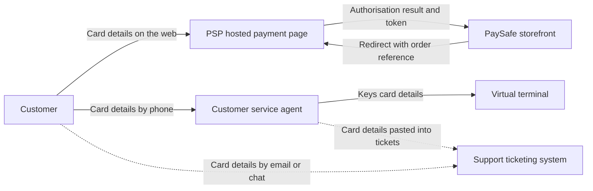

# PCI DSS v4.0.1 Gap Assessment: PaySafe Retail (Fictional)

> **Fictional portfolio project.** PaySafe Retail does not exist. Every system, person, number and piece of evidence below is invented for practice. This is not a real client engagement, not a Report on Compliance, and not an assessment by a Qualified Security Assessor (QSA).

| | |
|---|---|
| **Document** | Gap assessment against PCI DSS v4.0.1 |
| **Version / date** | 1.0, 24 October 2026 |
| **Prepared by** | Martin Searle (simulated role: GRC analyst) |
| **Organisation** | PaySafe Retail, a fictional UK online retailer |
| **Status** | Portfolio simulation |

## Contents

1. [Executive summary](#1-executive-summary)
2. [Scope and approach](#2-scope-and-approach)
3. [The scoping finding that changes everything](#3-the-scoping-finding-that-changes-everything)
4. [Results by requirement](#4-results-by-requirement)
5. [Detailed findings](#5-detailed-findings)
6. [Remediation roadmap](#6-remediation-roadmap)
7. [How findings were rated](#7-how-findings-were-rated)
8. [Limitations](#8-limitations)
9. [References](#9-references)

---

## 1. Executive summary

**PaySafe Retail is not ready to attest to PCI DSS compliance.** The assessment found 11 gaps: 4 High, 5 Medium and 2 Low. Of the 12 principal requirements, 2 are compliant, 8 are partially compliant, 1 is not compliant and 1 is covered by inheritance from providers.

The company believes it can validate compliance with the shortest self-assessment questionnaire because customers type their card details into a payment provider's hosted page. The evidence does not support that belief:

- Customer service agents take card details by phone and key them into a virtual terminal.
- Full card numbers were found in the support ticketing system in **14 of 60 sampled tickets (23%)**.
- No data-flow diagram or written scope decision exists to show which systems touch card data.

The three actions that matter most:

1. **Remove and stop card numbers entering the ticketing system** (finding F-02). This is live exposure of account data.
2. **Document the real card data flows and confirm the scope** with the acquirer (F-01). Every other requirement depends on it.
3. **Require multi-factor authentication for the 25 agents who use the virtual terminal** (F-04).

If these three are done within 30 days and the rest of the roadmap in [section 6](#6-remediation-roadmap) is followed, a re-assessment at day 90 is realistic.

## 2. Scope and approach

**The company.** PaySafe Retail is a fictional online retailer with about 120 staff and roughly 600,000 card transactions a year. Merchant level and the validation route are decided by the acquirer and the card brands, so they are treated here as assumptions to confirm.

**Systems and people in scope:**

| Component | Role in card payments |
|---|---|
| Online storefront (cloud hosted) | Takes orders and sends the customer to the payment provider's page |
| Payment service provider (PSP) hosted payment page | Customer enters card details here |
| Virtual terminal (PSP browser tool) | Agents key in card details for phone orders |
| Customer service team (25 agents) and their laptops | Use the virtual terminal and the ticketing system |
| Support ticketing system (SaaS) | Holds customer queries and attachments |
| Logging and monitoring platform | Collects security logs |

**Method.** The assessment compared the company's practice with each of the 12 principal requirements of PCI DSS v4.0.1 and the sub-requirements most relevant to a small e-commerce merchant. For each requirement the evidence reviewed was a mix of documents, configuration screenshots, system samples and staff interviews. All of it is fictional. Each gap is rated on the criteria in [section 7](#7-how-findings-were-rated).

**What was not done.** No technical testing, no network scans and no review of the payment provider's own environment. The provider's compliance is checked only through the evidence it supplies.

## 3. The scoping finding that changes everything

The company's working assumption, recorded in its 2024 scope note, is that card data never touches its own systems:

> The customer is redirected to the PSP's hosted payment page. PaySafe Retail never sees the card number.

If that were fully true, a small questionnaire written for fully outsourced e-commerce merchants (SAQ A) would probably apply, with a much smaller set of requirements. The assessment tested the assumption by following card data through the business. It found two flows that sit outside the documented design:

*Solid lines are the documented design. Dotted lines are flows found during the assessment.*

**Consequences:**

- The agents' laptops, the virtual terminal access and the ticketing system all come into scope for card data protection.
- The ticketing system is storing card numbers, which a hosted-page-only design is meant to avoid altogether.
- SAQ A is unlikely to be the right validation route. Which questionnaire applies (for example SAQ C-VT or SAQ D) is for the acquirer to confirm, and this document does not decide it.

Some of the remaining 10 findings only apply because of this wider scope. If the company stopped taking card details by phone and stopped card data reaching tickets, its scope would shrink again. That choice, reducing scope rather than securing more systems, is the most cost-effective option and is covered in finding F-01.

## 4. Results by requirement

| Req | Title (short) | Result | Findings |
|---|---|---|---|
| 1 | Network security controls | Partially compliant | F-01 |
| 2 | Secure configurations | Partially compliant | F-09 |
| 3 | Protect stored account data | **Not compliant** | F-02 |
| 4 | Protect data in transit | Compliant | None |
| 5 | Protect against malware | Compliant | None |
| 6 | Secure systems and software | Partially compliant | F-03, F-06 |
| 7 | Restrict access by need to know | Partially compliant | F-08 |
| 8 | Identify users and authenticate access | Partially compliant | F-04 |
| 9 | Restrict physical access | Inherited from providers | None |
| 10 | Log and monitor access | Partially compliant | F-05 |
| 11 | Test security regularly | Partially compliant | F-03, F-06 |
| 12 | Policies and programs | Partially compliant | F-01, F-07, F-10, F-11 |

**What is working:**

- **Requirement 4:** TLS 1.2 or higher was enforced on the storefront and on all 4 sampled public endpoints.
- **Requirement 5:** endpoint protection was running on 20 of 20 sampled agent laptops.
- **Requirement 9:** PaySafe Retail keeps no cardholder data in its own facilities. Physical controls for hosting come from the cloud provider, whose compliance evidence is on file.

## 5. Detailed findings

Each finding states what the standard asks for (in plain words, not quoted), what was found, the risk, the rating with its reasons, the recommended action and how closure would be verified.

### High severity

#### F-01 Scope and card data flows are not documented or confirmed
**Requirements:** 1.2.4, 12.5.2

| | |
|---|---|
| **Standard asks for** | An accurate diagram of how account data flows through systems, and confirmation of the PCI DSS scope at least every 12 months. |
| **Found** | No data-flow diagram exists. The 2024 scope note assumes card data never reaches PaySafe systems. Two flows contradict this (phone orders and card data in tickets). |
| **Risk** | Controls are applied to the wrong systems, some in-scope systems are missed, and the company may validate against the wrong questionnaire. |
| **Rating** | **High.** Nature: a required element is absent. Extent: it affects the whole assessment, not one control. No compensating control exists. |
| **Action** | Draw the real data-flow diagram, record a scope decision, and take it to the acquirer to agree the validation route. Consider ending phone card payments (for example by sending customers a secure payment link) to shrink scope. |
| **Owner / target** | Head of Compliance, 30 days. |
| **Closure check** | Approved diagram and scope statement reviewed, acquirer's written confirmation of the validation route on file. |

#### F-02 Full card numbers are stored in the support ticketing system
**Requirements:** 3.2.1, 3.5.1, 4.2.2

| | |
|---|---|
| **Standard asks for** | Account data kept to a minimum and deleted when no longer needed, stored card numbers made unreadable, and card numbers never sent in unprotected end-user messaging such as email or chat. |
| **Found** | 14 of 60 sampled tickets (23%) contained a full card number, and 5 of those 14 began as customer emails. No security codes (CVV) were found in the sample. Some tickets are over 12 months old. The system keeps tickets indefinitely and does not mask card numbers. |
| **Risk** | Anyone with ticketing access, and anyone who compromises that SaaS account, can read card numbers. This is the most direct exposure of cardholder data found. |
| **Rating** | **High.** Nature: a control is absent. Extent: nearly a quarter of the sample, and the pattern is recurring. Exposure: full card numbers in a system not designed to protect them. |
| **Action** | Search the ticket system and securely delete or redact existing card numbers. Add automatic detection and masking of card numbers on ticket creation. Give agents a secure alternative (payment link) and tell customers not to send card details by email. |
| **Owner / target** | Head of Customer Service with IT, 14 days for the clean-up, 30 days for automatic masking. |
| **Closure check** | A fresh search of the whole system finds no card numbers, and a test ticket containing a card number is masked automatically. |

#### F-03 Scripts on the checkout page are not inventoried, authorised or monitored
**Requirements:** 6.4.3, 11.6.1

| | |
|---|---|
| **Standard asks for** | A list of every script on payment pages with a reason for each, a check that each is authorised and unaltered, and a way to detect unauthorised changes to those pages. |
| **Found** | 11 third-party scripts load on the checkout pages. None has documented authorisation or an integrity check, and no change-detection alerting is in place. |
| **Risk** | A compromised script could skim card details as customers type them, a well-known attack on online stores. The hosted payment page reduces but does not remove this risk. |
| **Rating** | **High.** Nature: a required element is absent. Extent: all checkout pages. Exposure: direct route to customers' card details. |
| **Action** | Inventory and justify each script, remove any that are not needed, add integrity checks where possible, and deploy a page-change detection tool with alerts. |
| **Owner / target** | Head of E-commerce, 60 days. |
| **Closure check** | Approved script inventory, a test change to the page triggers an alert. |

#### F-04 Multi-factor authentication is not enforced for virtual terminal users
**Requirements:** 8.4.1, 8.4.2

| | |
|---|---|
| **Standard asks for** | Multi-factor authentication for administrators, and for all access into the cardholder data environment. |
| **Found** | MFA is enforced for all 6 cloud administrators. The 25 agents who use the virtual terminal sign in with a password only. |
| **Risk** | One phished or reused password gives an attacker the ability to take card payments or view card data. |
| **Rating** | **High.** Nature: a control is absent for a defined group. Extent: all virtual terminal users. Exposure: direct access to card handling. |
| **Action** | Turn on MFA for the virtual terminal and ticketing system for all agents. Confirm no shared accounts exist. |
| **Owner / target** | Head of IT, 30 days. |
| **Closure check** | Configuration inspected, and a sign-in test without MFA is refused for 5 sampled agents. |

### Medium severity

#### F-05 Logs are kept for too short a time and not reviewed daily
**Requirements:** 10.4.1, 10.5.1

| | |
|---|---|
| **Standard asks for** | Daily review of security logs (automated where possible), and 12 months of log history with the last 3 months immediately available. |
| **Found** | Logs are retained for 90 days. Evidence of a daily review exists for 6 of 20 sampled days (30%). |
| **Risk** | An attack could go unnoticed, and investigators would lack history if an incident were found late. |
| **Rating** | **Medium.** Nature: the control operates inconsistently. Extent: 70% of sampled days. Exposure: indirect, because card entry happens at the provider. |
| **Action** | Extend retention to 12 months, set up automated alerting for key events, and record the daily review. |
| **Owner / target** | Head of IT, 60 days. |
| **Closure check** | Retention setting inspected, 20 sampled days show review evidence. |

#### F-06 Vulnerability patching and scanning evidence is incomplete
**Requirements:** 6.3.3, 11.3.1, 11.3.2

| | |
|---|---|
| **Standard asks for** | Critical patches within one month, internal vulnerability scans at least quarterly, and quarterly external scans by an approved scanning vendor where they apply to the validation route. |
| **Found** | 3 of 12 sampled critical vulnerabilities (25%) were fixed after 30 days. Internal scan reports exist for 2 of the last 4 quarters. No passing external scan report was found for the last 12 months. |
| **Risk** | Known weaknesses stay open longer than the standard allows. |
| **Rating** | **Medium.** Nature: the control operates inconsistently. Extent: 25% of sampled vulnerabilities and half of the quarters. Whether the external scan is required depends on the validation route (F-01). |
| **Action** | Set a 30-day patch deadline with exceptions approved in writing, schedule all four quarterly scans, and book an approved external scan. |
| **Owner / target** | Head of IT, 60 days. |
| **Closure check** | Four consecutive quarters of scan reports, 12 of 12 sampled critical vulnerabilities fixed on time. |

#### F-07 Third-party service providers are not tracked or monitored
**Requirements:** 12.8.1, 12.8.4, 12.8.5

| | |
|---|---|
| **Standard asks for** | A list of providers that touch card data, a yearly check of each provider's PCI DSS status, and a record of which requirements each provider handles and which the company handles. |
| **Found** | 5 providers are used. The list has no responsibility matrix. A current Attestation of Compliance is on file for 2 of 5 (40%), and the payment provider's is more than 12 months old. |
| **Risk** | The company cannot show that the provider handling card entry is still compliant, and gaps between provider and company duties go unseen. |
| **Rating** | **Medium.** Nature: the control operates inconsistently. Extent: 3 of 5 providers. The payment provider's evidence is the most important and the easiest to refresh. |
| **Action** | Build the provider list and responsibility matrix, request current attestations, and diarise a yearly review. |
| **Owner / target** | Procurement Lead, 45 days. |
| **Closure check** | Matrix approved, current attestations on file for all 5 providers. |

#### F-08 User access is not reviewed and leavers keep access
**Requirements:** 7.2.4, 8.2.x

| | |
|---|---|
| **Standard asks for** | A review of all user accounts and their access at least every six months, and prompt removal of access when someone leaves. |
| **Found** | No access review took place in the last 12 months for the virtual terminal or the ticketing system. 4 of 15 sampled leavers (27%) kept access for up to 31 days. |
| **Risk** | Former staff could still reach card handling tools. |
| **Rating** | **Medium.** Nature: the control operates inconsistently. Extent: 27% of leavers. Mitigating: MFA on other systems and no evidence of misuse. |
| **Action** | Run an access review now, link leaver notices from HR to access removal, and repeat every six months. |
| **Owner / target** | Head of IT with HR, 45 days. |
| **Closure check** | Signed review for each system, 15 new sampled leavers all removed within 24 hours. |

#### F-10 Awareness training does not cover card data handling and the policy is out of date
**Requirements:** 12.1.2, 12.6.1, 12.6.3

| | |
|---|---|
| **Standard asks for** | A security policy reviewed at least yearly, and awareness training for all staff that covers the threats they face. |
| **Found** | 18 of 25 agents (72%) completed annual training, and the training has no section on handling card details. The PCI policy was last reviewed in March 2025. |
| **Risk** | This is a root cause of F-02: agents were never told not to paste card numbers into tickets. |
| **Rating** | **Medium.** Nature: the control operates inconsistently and its content is incomplete. Extent: 28% of agents untrained. |
| **Action** | Add a card-handling module, require completion by all agents, and review the policy. |
| **Owner / target** | Head of Customer Service with Compliance, 45 days. |
| **Closure check** | 100% agent completion, policy review signed, and a repeat ticket sample finds no card numbers. |

### Low severity

#### F-09 Agent laptops drift from the secure build
**Requirements:** 2.2.1

| | |
|---|---|
| **Standard asks for** | Documented secure configuration standards that are applied and kept up to date. |
| **Found** | A build standard exists. 6 of 20 sampled laptops (30%) differ from it. |
| **Risk** | Weakened laptops are a way into card handling tools. |
| **Rating** | **Low.** Nature: the control operates inconsistently, but endpoint protection is on all sampled laptops and MFA is planned (F-04), which limit the effect. |
| **Action** | Enforce the build standard through device management and report on drift monthly. |
| **Owner / target** | Head of IT, 90 days. |
| **Closure check** | Re-sample 20 laptops, none outside the standard without an approved exception. |

#### F-11 The incident response plan is untested and misses card brand notification
**Requirements:** 12.10.1, 12.10.2

| | |
|---|---|
| **Standard asks for** | An incident response plan that covers card data incidents, tested at least yearly. |
| **Found** | A plan exists. It was not tested in the last 12 months and has no step for notifying the acquirer and card brands. |
| **Risk** | A card data incident would be handled without a rehearsed process or the required notifications. |
| **Rating** | **Low.** Nature: documentation gap and an overdue test. The plan exists and no incident has occurred. |
| **Action** | Add the notification step and hold a tabletop exercise based on the F-02 scenario. |
| **Owner / target** | Head of Compliance, 90 days. |
| **Closure check** | Updated plan approved and a tabletop report with actions on file. |

## 6. Remediation roadmap

| Window | Actions | Why this order |
|---|---|---|
| **Days 0 to 30** | F-02 clean-up and masking, F-01 data-flow diagram and scope decision, F-04 MFA | Live exposure of card numbers and the scope decision that everything else depends on |
| **Days 31 to 60** | F-03 checkout scripts, F-05 logging, F-06 patching and scans, F-07 provider evidence, F-08 access review, F-10 training and policy | Controls that reduce likelihood once scope is fixed |
| **Days 61 to 90** | F-09 build drift, F-11 incident exercise | Lower severity items |
| **Day 90** | Re-test every High and Medium finding with a fresh sample | A completed action shows the fix was made. Only a re-test shows it works |

## 7. How findings were rated

Ratings are the assessor's judgement. They are not set automatically from a failed check. For each gap the following were weighed:

- **Nature:** is a required element absent, does the control operate inconsistently, or is it a documentation gap?
- **Extent:** how much of the sample or population is affected?
- **Exposure:** could the failure expose cardholder data, or does it only weaken supporting controls?
- **Compensating factors:** what other controls reduce the effect?

| Rating | Meaning |
|---|---|
| **High** | A required element is absent or failing in a way that directly exposes card data or undermines the scope. |
| **Medium** | A control operates inconsistently or evidence is missing, with indirect exposure. |
| **Low** | An isolated lapse or documentation gap with compensating controls in place. |

Borderline calls: F-03 could be argued as Medium because the hosted payment page limits exposure. It is rated High because the requirement is absent and the checkout page is a common attack target.

## 8. Limitations

- All evidence, numbers, systems and people are invented.
- Samples are small and illustrative, not statistically valid.
- Requirement numbers follow PCI DSS v4.0.1 and were written from the author's understanding of the standard. Check them against the current text before relying on them.
- The validation route, merchant level and the applicability of each requirement are decided by the acquirer and the card brands, not by this document.
- This is a learning exercise, not a compliance opinion.

## 9. References

- [PCI Security Standards Council document library](https://www.pcisecuritystandards.org/document_library/) for the PCI DSS v4.0.1 standard, the self-assessment questionnaires and the guidance on scoping.
